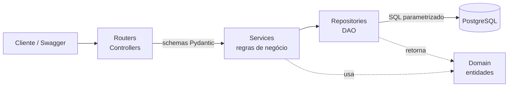

# Picped

**Plataforma inteligente de comparação de preços e economia domésticos.**

API REST que registra preços de produtos em supermercados de Manaus, identifica em qual mercado o
usuário está pela localização do celular e compara o preço atual de cada produto entre os mercados,
mostrando quanto dá para economizar.

> Projeto da disciplina **Linguagem de Programação de Banco de Dados** — Ciência da Computação (UNIP Manaus),
> Prof. MSc. Mateus de Paula. Equipe **PSICODE**: André Fecury, Luiz Fecury e Luís Eduardo San Martin.

[](https://gitlab.com/psicode1/picped/-/pipelines)

## Sumário

- [Stack](#stack)
- [Arquitetura](#arquitetura)
- [Estrutura de pastas](#estrutura-de-pastas)
- [Pré-requisitos](#pré-requisitos)
- [Como executar (Docker Compose)](#como-executar-docker-compose)
- [Como executar sem Docker](#como-executar-sem-docker)
- [Variáveis de ambiente](#variáveis-de-ambiente)
- [Rotas da API](#rotas-da-api)
- [Testes](#testes)
- [CI/CD (GitLab CI)](#cicd-gitlab-ci)
- [Convenção de commits](#convenção-de-commits)

## Stack

| Camada | Tecnologia |
|---|---|
| Linguagem | Python 3.12 |
| Framework web | FastAPI + Uvicorn |
| Acesso a dados | SQLAlchemy 2 (pool de conexões) + psycopg 3, SQL parametrizado |
| Banco | PostgreSQL 16 |
| Validação / docs | Pydantic 2 + Swagger UI (OpenAPI) |
| Testes | Pytest + HTTPX (`TestClient`) |
| Infra | Docker (multi-stage, não-root) + Docker Compose |
| CI/CD | GitLab CI (lint → testes → build) |

## Arquitetura



- **Domain** (`app/domain/`): entidades do negócio, sem framework nem banco.
- **Repository/DAO** (`app/repositories/`): único ponto que fala com o banco; só consultas parametrizadas.
- **Service** (`app/services/`): regras de negócio (raio do supermercado, mercado inativo, e-mail único, comparação).
- **Routers** (`app/routers/`) + **Schemas** (`app/schemas/`): HTTP, validação estrita de entrada e saída.
- **Core** (`app/core/`): configuração, pool de conexões e tratamento centralizado de erros.

Detalhes em [`docs/arquitetura.md`](docs/arquitetura.md). Modelo de dados (ER, 3FN) e dicionário de dados em
[`docs/dicionario-de-dados.md`](docs/dicionario-de-dados.md).

## Estrutura de pastas

```text
picped/
├── app/
│   ├── core/           # config, pool de conexões, exceções/handlers
│   ├── domain/         # entidades (dataclasses)
│   ├── repositories/   # DAO (SQL parametrizado)
│   ├── services/       # regras de negócio
│   ├── schemas/        # Pydantic (entrada/saída + exemplos do Swagger)
│   ├── routers/        # endpoints
│   ├── dependencies.py # injeção de dependências
│   └── main.py         # app FastAPI
├── scripts/
│   ├── schema.sql      # DDL + índices + função supermercados_proximos
│   └── seed.sql        # dados iniciais
├── tests/              # Pytest + HTTPX
├── docs/               # arquitetura e dicionário de dados
├── Dockerfile          # multi-stage: builder → test → runtime (não-root)
├── docker-compose.yml  # db + api (+ tests com --profile test)
├── .gitlab-ci.yml      # pipeline lint → test → build
├── requirements.txt    # dependências da API
└── requirements-dev.txt# dependências de teste/lint
```

## Pré-requisitos

- [Docker Desktop](https://www.docker.com/products/docker-desktop/) com Docker Compose v2 (`docker compose version`)
- Git
- Opcional, para rodar sem Docker: Python 3.12+ e um PostgreSQL 16

## Como executar (Docker Compose)

```bash
git clone https://gitlab.com/psicode1/picped.git
cd picped
copy .env.example .env          # Windows  (Linux/Mac: cp .env.example .env)
docker compose up -d --build
docker compose ps               # db e api devem aparecer como "healthy"
```

| O quê | Onde |
|---|---|
| Swagger UI | http://localhost:8000/docs |
| ReDoc | http://localhost:8000/redoc |
| Health check | http://localhost:8000/health |

Comandos úteis:

```bash
docker compose logs -f api                          # logs da API
docker compose exec db psql -U postgres -d picped   # acessar o banco
docker compose exec api whoami                      # -> picped (usuário não-root)
docker compose down                                 # para (dados ficam no volume picped_pgdata)
docker compose down -v                              # para e APAGA o banco (recria com schema + seed)
```

O `schema.sql` e o `seed.sql` rodam automaticamente só na **primeira** inicialização (volume vazio).
O banco fica numa rede interna (`internal: true`), sem porta publicada: só a API acessa.

## Como executar sem Docker

Precisa de um PostgreSQL rodando em `localhost:5432` com o banco `picped` criado.

```bash
python -m venv .venv
.venv\Scripts\activate                  # Windows (Linux/Mac: source .venv/bin/activate)
pip install -r requirements-dev.txt
copy .env.example .env
psql -U postgres -d picped -f scripts/schema.sql -f scripts/seed.sql
uvicorn app.main:app --reload
```

## Variáveis de ambiente

Todas estão documentadas em [`.env.example`](.env.example). O `.env` real não vai para o Git.

| Variável | Padrão | Descrição |
|---|---|---|
| `DB_HOST` | `localhost` | Host do PostgreSQL (no compose vira `db` automaticamente) |
| `DB_PORT` | `5432` | Porta do PostgreSQL |
| `DB_NAME` | `picped` | Nome do banco |
| `DB_USER` | `postgres` | Usuário do banco |
| `DB_PASSWORD` | — | Senha do banco (**obrigatória** no compose) |
| `API_PORT` | `8000` | Porta da API no host |
| `DB_POOL_SIZE` | `5` | Conexões mantidas no pool |
| `DB_POOL_MAX_OVERFLOW` | `10` | Conexões extras em pico |
| `DB_POOL_TIMEOUT` | `30` | Segundos esperando uma conexão livre |
| `DB_POOL_RECYCLE` | `1800` | Segundos até renovar uma conexão |
| `DB_CONNECT_TIMEOUT` | `5` | Segundos para desistir de conectar (API responde 503) |
| `TEST_DB_NAME` | `picped_test` | Banco usado pelos testes (é apagado e recriado a cada teste) |

## Rotas da API

Todos os recursos têm CRUD completo. Listagens aceitam `?limit=` (1–200, padrão 50) e `?offset=`.

| Método | Rota | Descrição | Sucesso |
|---|---|---|---|
| GET | `/health` | Status da API e do banco | 200 |
| GET | `/categorias` | Lista categorias | 200 |
| POST | `/categorias` | Cria categoria | 201 |
| GET | `/categorias/{id}` | Obtém categoria | 200 |
| PUT | `/categorias/{id}` | Substitui categoria | 200 |
| PATCH | `/categorias/{id}` | Atualiza parte da categoria | 200 |
| DELETE | `/categorias/{id}` | Exclui categoria | 204 |
| GET | `/produtos` | Lista produtos | 200 |
| POST | `/produtos` | Cria produto (categoria precisa existir) | 201 |
| GET | `/produtos/{id}` | Obtém produto | 200 |
| GET | `/produtos/{id}/comparacao` | Preço atual em cada mercado + economia (R$ e %) | 200 |
| PUT | `/produtos/{id}` | Substitui produto | 200 |
| PATCH | `/produtos/{id}` | Atualiza parte do produto | 200 |
| DELETE | `/produtos/{id}` | Exclui produto | 204 |
| GET | `/supermercados` | Lista supermercados | 200 |
| GET | `/supermercados/proximos?latitude=&longitude=` | Mercados cujo raio contém a posição do usuário | 200 |
| POST | `/supermercados` | Cria supermercado | 201 |
| GET | `/supermercados/{id}` | Obtém supermercado | 200 |
| PUT | `/supermercados/{id}` | Substitui supermercado | 200 |
| PATCH | `/supermercados/{id}` | Atualiza parte (ex.: `{"ativo": false}`) | 200 |
| DELETE | `/supermercados/{id}` | Exclui supermercado | 204 |
| GET | `/usuarios` | Lista usuários (sem senha) | 200 |
| POST | `/usuarios` | Cadastra usuário (senha vira hash PBKDF2) | 201 |
| GET | `/usuarios/{id}` | Obtém usuário | 200 |
| PUT | `/usuarios/{id}` | Substitui usuário | 200 |
| PATCH | `/usuarios/{id}` | Atualiza parte do usuário | 200 |
| DELETE | `/usuarios/{id}` | Exclui usuário | 204 |
| GET | `/precos?produto_id=&supermercado_id=` | Lista preços (mais recentes primeiro) | 200 |
| POST | `/precos` | Registra preço (aplica as regras de negócio) | 201 |
| GET | `/precos/{id}` | Obtém preço | 200 |
| PUT | `/precos/{id}` | Substitui preço | 200 |
| PATCH | `/precos/{id}` | Corrige o valor | 200 |
| DELETE | `/precos/{id}` | Exclui preço | 204 |

**Erros** — sempre no mesmo formato:

```json
{ "erro": { "codigo": "regra_de_negocio", "mensagem": "Registro rejeitado: o usuário está a 120 m do supermercado (máximo permitido: 80 m).", "detalhes": [] } }
```

| Status | Quando |
|---|---|
| 400 | JSON mal formatado ou PATCH sem campos |
| 404 | Registro ou rota inexistente |
| 409 | Registro duplicado, e-mail já cadastrado ou exclusão de registro em uso |
| 422 | Dados inválidos (validação estrita) ou regra de negócio violada |
| 503 | Banco indisponível |

**Exemplo** — registrar um preço:

```bash
curl -X POST http://localhost:8000/precos \
  -H "Content-Type: application/json" \
  -d '{"produto_id": 1, "supermercado_id": 2, "usuario_id": 1, "valor": 29.90, "distancia_metros": 20}'
```

## Testes

124 testes (Pytest + HTTPX) cobrindo todos os endpoints: sucesso, erros (400/404/409/422) e regras de
negócio, com asserções de status HTTP e da estrutura do JSON. Rodam contra um PostgreSQL real, num banco
separado (`picped_test`) que é recriado com `schema.sql` + `seed.sql` antes de cada teste.

**Com Docker (recomendado):**

```bash
docker compose up -d db
docker compose --profile test run --rm --build tests
```

**Sem Docker** (PostgreSQL em `localhost`):

```bash
pip install -r requirements-dev.txt
pytest -v
ruff check .        # lint
```

## CI/CD (GitLab CI)

O [`.gitlab-ci.yml`](.gitlab-ci.yml) roda em todo push e merge request:

| Stage | Job | O que faz |
|---|---|---|
| `lint` | `lint` | `ruff check .` |
| `test` | `test` | `pytest` contra o serviço `postgres:16-alpine`, gera relatório JUnit |
| `build` | `build-docker` | `docker build` da imagem final (estágio `runtime`) e confere que roda como não-root |

## Convenção de commits

Seguimos [Conventional Commits](https://www.conventionalcommits.org/pt-br/v1.0.0/):

```text
<tipo>(escopo opcional): descrição no imperativo
```

| Tipo | Uso |
|---|---|
| `feat` | nova funcionalidade |
| `fix` | correção de bug |
| `docs` | documentação |
| `test` | testes |
| `build` | Docker, dependências |
| `ci` | pipeline |
| `refactor` | mudança de código sem alterar comportamento |
| `chore` | manutenção (gitignore, configs) |

Exemplos do histórico: `feat(db): adiciona schema.sql e seed.sql do PostgreSQL`,
`build(docker): Dockerfile multi-stage não-root e compose com healthcheck`.
