<p align="center">
  <a href="https://github.com/AndreFecury/picped/actions/workflows/ci.yml"></a>
  
  
  
  
  
</p>

**Picped** é uma plataforma colaborativa de comparação de preços de supermercados em Manaus. Os próprios
usuários registram o preço que estão vendo na prateleira; a **API** confirma pelo GPS que a pessoa está
mesmo dentro do mercado, guarda o histórico e responde em qual loja cada produto (ou a lista de compras
inteira) sai mais barato. O **app Android** em Flutter consome essa API.

O coração do projeto é a **API autoral**: modelagem do banco, SQL, regras de negócio, autenticação,
tratamento de erros, testes e infraestrutura foram escritos pela equipe, sem geradores de CRUD e sem ORM
"mágico". Este README documenta essa parte em detalhe.

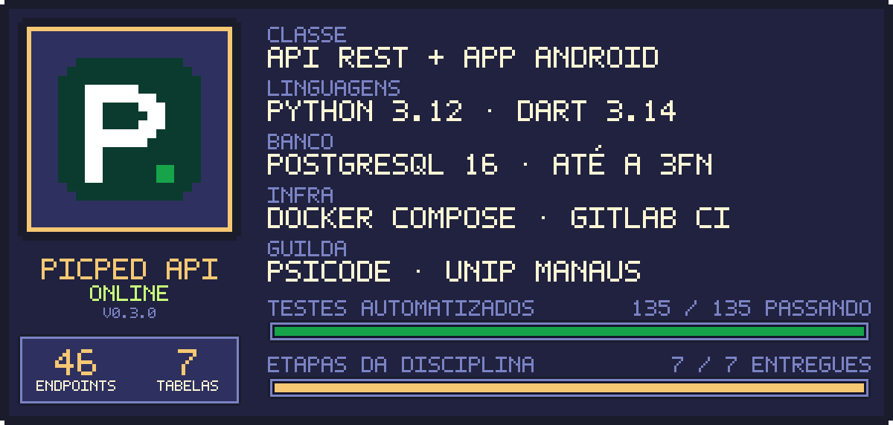

<p align="center">
  <a href="#telas">Telas</a> ·
  <a href="#arquitetura">Arquitetura</a> ·
  <a href="#banco">Banco de dados</a> ·
  <a href="#regras">Regras de negócio</a> ·
  <a href="#endpoints">Endpoints</a> ·
  <a href="#erros">Erros</a> ·
  <a href="#seguranca">Segurança</a> ·
  <a href="#testes">Testes e CI</a> ·
  <a href="#docker">Docker</a> ·
  <a href="#rodar">Como rodar</a> ·
  <a href="#decisoes">Decisões técnicas</a> ·
  <a href="#equipe">Equipe</a>
</p>

<a id="sobre"></a>

##  Sobre o projeto

O mesmo produto pode custar 15% a mais no mercado ao lado, e ninguém tem tempo de rodar a cidade
conferindo etiqueta. O Picped resolve isso com dados da comunidade:

| Problema | Como o Picped resolve |
|---|---|
| Preço registrado de longe ou inventado | O registro só é aceito se a distância do usuário até o mercado estiver dentro do raio da loja (GPS + fórmula de Haversine no PostgreSQL) |
| "Qual mercado é mais barato para **este** produto?" | `GET /produtos/{id}/comparacao`: último preço de cada loja, do menor para o maior, com economia em R$ e % |
| "E para a minha lista inteira?" | `GET /listas/{id}/comparacao`: total da lista em cada mercado, separando quem tem todos os itens dos parciais |
| O preço subiu ou caiu? | `GET /produtos/{id}/historico`: mínimo, média, máximo e variação, calculados só com registros reais |
| Privacidade | Senha só como hash PBKDF2, token assinado, cada usuário só enxerga as próprias listas e pode excluir a conta (LGPD) |

O projeto nasceu na disciplina **Linguagem de Programação de Banco de Dados** (Ciência da Computação,
UNIP Manaus, Prof. MSc. Mateus de Paula), entregue em 7 etapas: modelagem, backend, conteinerização,
endpoints, testes, documentação e CI/CD. O app Android foi construído em seguida para a **APS** do curso,
usando a mesma API.

<a id="telas"></a>

##  Telas do app

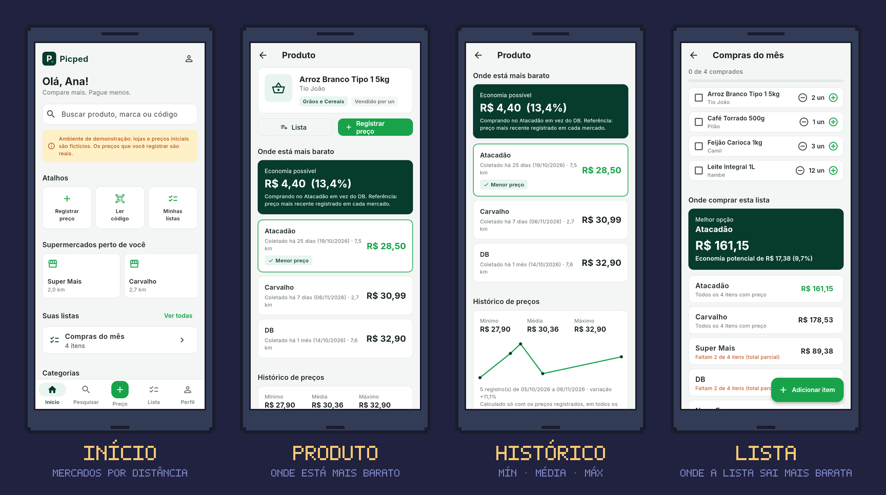

<sub>Capturas reais da versão web do app (a mesma base de código Flutter do Android) consumindo a API
local com os dados demonstrativos de <code>scripts/seed.sql</code> e <code>scripts/demo.sql</code>.
Lojas e preços são fictícios.</sub>

O app (pasta [`mobile/`](mobile/)) usa Flutter 3.50, Riverpod, go_router, Dio, token no
`flutter_secure_storage` (Keystore do Android), `geolocator` para o GPS e `mobile_scanner` para ler o
código de barras pela câmera. Detalhes em [`mobile/README.md`](mobile/README.md).

<a id="arquitetura"></a>

##  Arquitetura

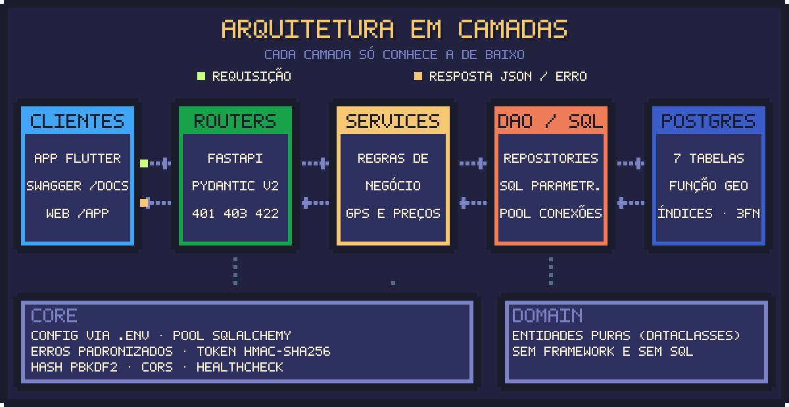

Cada camada tem uma responsabilidade e só conhece a camada de baixo. Trocar o banco, o framework web
ou a forma de autenticação mexe em um lugar só.

| Camada | Pasta | Responsabilidade |
|---|---|---|
| **Routers** | [`app/routers/`](app/routers/) | HTTP puro: rota, status code, documentação do Swagger e injeção de dependências. Nenhuma regra de negócio |
| **Schemas** | [`app/schemas/`](app/schemas/) | Contrato de entrada e saída em Pydantic v2 com validação estrita (`extra="forbid"`, tipos estritos, tamanhos, `null` proibido em campos obrigatórios no PATCH) |
| **Services** | [`app/services/`](app/services/) | Regras de negócio: raio do mercado, mercado inativo, e-mail único, dono da lista, cálculos de economia e histórico |
| **Repositories (DAO)** | [`app/repositories/`](app/repositories/) | Único ponto que fala com o banco. SQL escrito à mão, sempre com parâmetros (`:valor`), nunca concatenado |
| **Domain** | [`app/domain/`](app/domain/) | Entidades como `dataclasses`, sem dependência de framework ou banco |
| **Core** | [`app/core/`](app/core/) | Configuração por variáveis de ambiente, pool de conexões, erros padronizados, token e segurança |

### Ciclo de uma requisição: registrar um preço

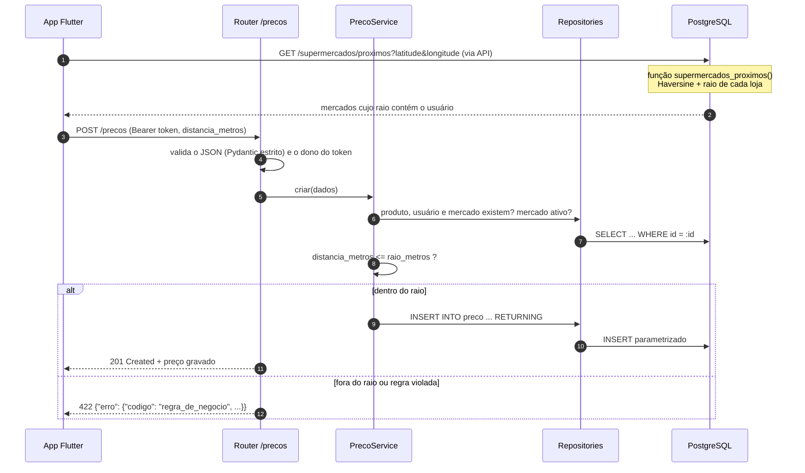

<a id="banco"></a>

##  Banco de dados

PostgreSQL 16, normalizado até a **3FN**, com integridade garantida no próprio banco (chaves, `UNIQUE`,
`CHECK`) e não só na aplicação. O DDL completo está em [`scripts/schema.sql`](scripts/schema.sql) e o
dicionário de dados em [`docs/dicionario-de-dados.md`](docs/dicionario-de-dados.md).

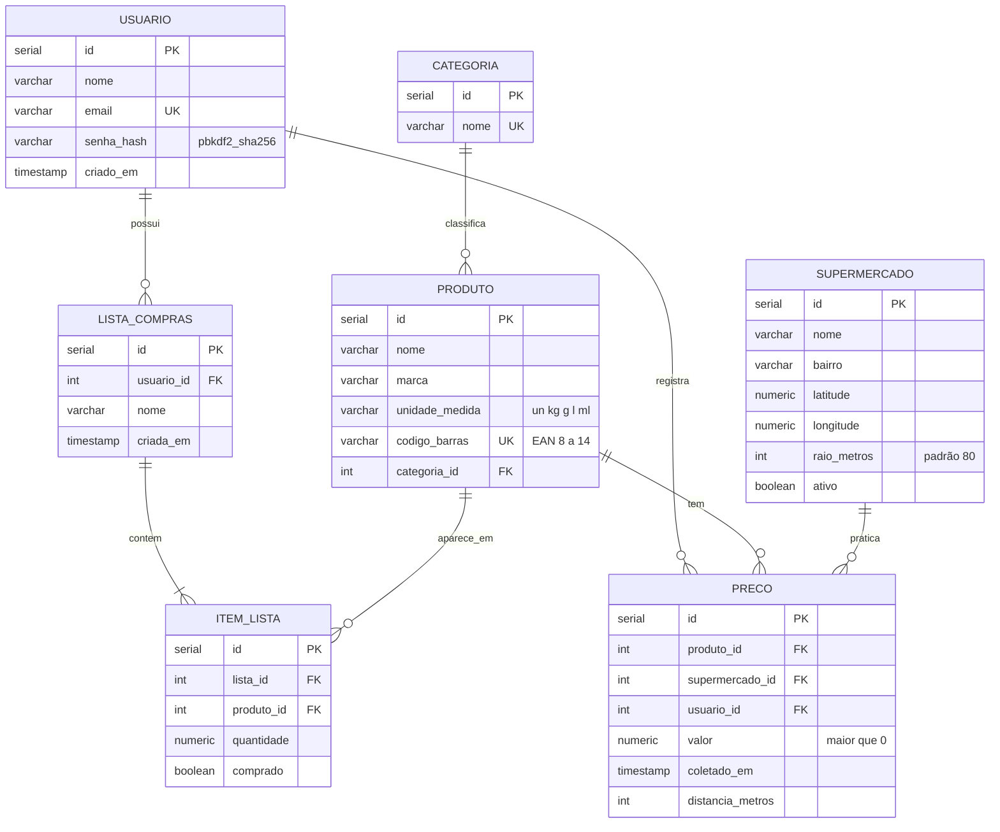

**Destaques do modelo**

| Recurso | Onde | Por quê |
|---|---|---|
| `preco` como tabela de histórico N:N | `produto` ↔ `supermercado` | Cada coleta é uma linha com data e autor; nada é sobrescrito, o que permite o histórico e a auditoria |
| `CHECK` de domínio | `valor > 0`, EAN só com 8 a 14 dígitos, unidade em `('un','kg','g','l','ml')`, latitude/longitude válidas | O banco recusa dado inválido mesmo se alguém escrever direto nele |
| `UNIQUE` compostos | `(nome, marca)`, `(nome, cidade, bairro)`, `(lista_id, produto_id)` | Evitam produto, mercado ou item de lista duplicados |
| `ON DELETE CASCADE` | listas e itens do usuário | Excluir a conta remove os dados pessoais junto (LGPD) |
| Índice composto | `preco (produto_id, supermercado_id, coletado_em DESC)` | Busca do "último preço de cada loja" sem varrer a tabela |
| Índice por expressão | `produto (LOWER(nome))` | Busca de produto sem diferenciar maiúsculas |
| Função SQL | `supermercados_proximos(lat, lon)` | Haversine dentro do banco: devolve até 3 mercados cujo raio contém o usuário |

```sql
-- trecho de scripts/schema.sql: distância em metros entre o usuário e cada mercado ativo
ROUND(6371000 * 2 * ASIN(SQRT(
    POWER(SIN(RADIANS(s.latitude::double precision - p_lat) / 2), 2) +
    COS(RADIANS(p_lat)) * COS(RADIANS(s.latitude::double precision)) *
    POWER(SIN(RADIANS(s.longitude::double precision - p_lon) / 2), 2)
)))::INTEGER AS distancia_metros
```

<a id="regras"></a>

##  Regras de negócio

### Preço só vale se foi visto na loja

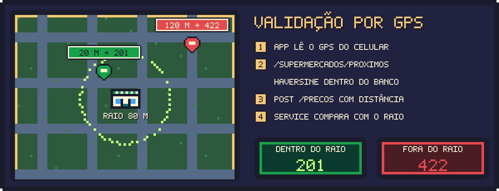

Em [`PrecoService`](app/services/preco_service.py), antes de gravar: o produto, o usuário e o mercado
precisam existir, o mercado precisa estar **ativo** e a `distancia_metros` não pode passar do
`raio_metros` da loja. Com token, o `usuario_id` do preço precisa ser o do próprio usuário logado
(senão **403**): ninguém registra preço em nome de outra pessoa.

### Onde a lista sai mais barata

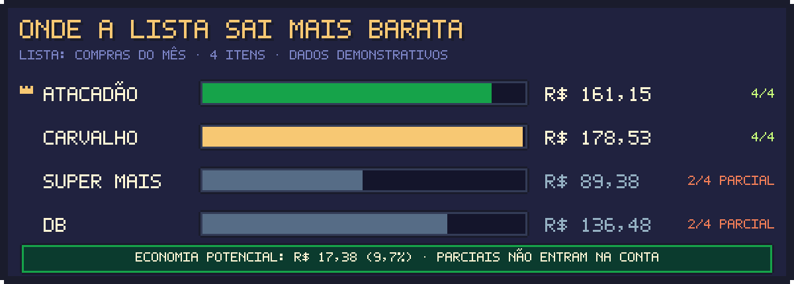

O algoritmo de [`ListaService.comparar`](app/services/lista_service.py) pega o preço **mais recente**
de cada item em cada mercado ativo e multiplica pela quantidade. Mercados com **todos** os itens vêm
primeiro, do mais barato ao mais caro; os que não têm algum item aparecem depois como **parciais**, porque
um total incompleto não é comparável com um completo. A economia potencial é a diferença entre o mercado
completo mais caro e o mais barato. A resposta inclui o campo `referencia`, que explica o cálculo para o
app mostrar ao usuário.

### Outras regras

| Regra | Resposta |
|---|---|
| E-mail já cadastrado (comparação sem diferenciar maiúsculas) | 409 |
| PATCH sem nenhum campo | 400 |
| Campo obrigatório enviado como `null` no PATCH | 422 |
| Lista ou item de outro usuário | 403 |
| Produto repetido na mesma lista | 409 (`UNIQUE (lista_id, produto_id)`) |
| Excluir categoria, produto, mercado ou usuário que ainda tem dados ligados | 409 (chave estrangeira traduzida pelo handler) |
| Histórico de preços | Calculado só com registros existentes; nada é estimado ou interpolado |

<a id="endpoints"></a>

##  Endpoints

**46 endpoints** documentados no Swagger (`/docs`) e no ReDoc (`/redoc`), com exemplos e todas as
respostas de erro possíveis. Listagens aceitam `?limit=` (1 a 200, padrão 50) e `?offset=`.
 = exige token Bearer.

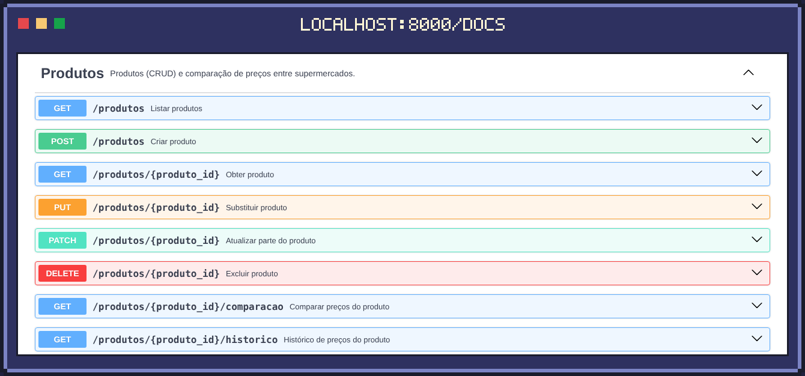

<details open>
<summary><b>Autenticação, listas de compras e saúde</b></summary>

| Método | Rota | O que faz | Sucesso |
|---|---|---|---|
| POST | `/auth/login` | Troca e-mail e senha por um token Bearer | 200 |
| GET | `/auth/me`  | Dados do usuário logado | 200 |
| DELETE | `/auth/me`  | Exclui a conta e os dados pessoais (LGPD) | 204 |
| GET | `/listas`  | Minhas listas, com total de itens | 200 |
| POST | `/listas`  | Cria uma lista | 201 |
| GET | `/listas/{id}`  | Lista com os itens detalhados | 200 |
| PATCH | `/listas/{id}`  | Renomeia | 200 |
| DELETE | `/listas/{id}`  | Exclui a lista e os itens | 204 |
| POST | `/listas/{id}/itens`  | Adiciona um produto com quantidade | 201 |
| PATCH | `/listas/{id}/itens/{item_id}`  | Altera quantidade ou marca como comprado | 200 |
| DELETE | `/listas/{id}/itens/{item_id}`  | Remove o item | 204 |
| GET | `/listas/{id}/comparacao`  | Em qual mercado a lista sai mais barata | 200 |
| GET | `/health` | Status da API e da conexão com o banco | 200 |

</details>

<details>
<summary><b>Produtos</b></summary>

| Método | Rota | O que faz | Sucesso |
|---|---|---|---|
| GET | `/produtos?busca=&codigo_barras=&categoria_id=` | Lista e filtra por nome/marca, EAN ou categoria | 200 |
| POST | `/produtos` | Cria (a categoria precisa existir) | 201 |
| GET | `/produtos/{id}` | Obtém | 200 |
| PUT | `/produtos/{id}` | Substitui todos os campos | 200 |
| PATCH | `/produtos/{id}` | Atualiza só os campos enviados | 200 |
| DELETE | `/produtos/{id}` | Exclui | 204 |
| GET | `/produtos/{id}/comparacao` | Último preço em cada mercado, menor e maior, economia em R$ e % | 200 |
| GET | `/produtos/{id}/historico` | Mínimo, média, máximo, variação e pontos para o gráfico | 200 |

</details>

<details>
<summary><b>Supermercados</b></summary>

| Método | Rota | O que faz | Sucesso |
|---|---|---|---|
| GET | `/supermercados` | Lista | 200 |
| GET | `/supermercados/proximos?latitude=&longitude=` | Mercados cujo raio contém a posição do usuário | 200 |
| POST | `/supermercados` | Cria | 201 |
| GET | `/supermercados/{id}` | Obtém | 200 |
| PUT | `/supermercados/{id}` | Substitui | 200 |
| PATCH | `/supermercados/{id}` | Atualiza parte (ex.: `{"ativo": false}`) | 200 |
| DELETE | `/supermercados/{id}` | Exclui | 204 |

</details>

<details>
<summary><b>Preços</b></summary>

| Método | Rota | O que faz | Sucesso |
|---|---|---|---|
| GET | `/precos?produto_id=&supermercado_id=` | Lista, mais recentes primeiro | 200 |
| POST | `/precos` | Registra aplicando as regras de GPS (token opcional; se enviado, o preço tem que ser do próprio usuário) | 201 |
| GET | `/precos/{id}` | Obtém | 200 |
| PUT | `/precos/{id}` | Substitui (mantém a data original se não for enviada) | 200 |
| PATCH | `/precos/{id}` | Corrige o valor | 200 |
| DELETE | `/precos/{id}` | Exclui | 204 |

</details>

<details>
<summary><b>Categorias e usuários</b></summary>

| Método | Rota | O que faz | Sucesso |
|---|---|---|---|
| GET | `/categorias` | Lista | 200 |
| POST | `/categorias` | Cria | 201 |
| GET · PUT · PATCH · DELETE | `/categorias/{id}` | Obtém, substitui, atualiza parte, exclui | 200 · 200 · 200 · 204 |
| GET | `/usuarios` | Lista (nunca devolve a senha nem o hash) | 200 |
| POST | `/usuarios` | Cadastra (a senha vira hash PBKDF2) | 201 |
| GET · PUT · PATCH · DELETE | `/usuarios/{id}` | Obtém, substitui, atualiza parte, exclui | 200 · 200 · 200 · 204 |

</details>

### Exemplo: do login à lista mais barata

```bash
# 1. login (usuário de demonstração do seed)
TOKEN=$(curl -s -X POST http://localhost:8000/auth/login \
  -H "Content-Type: application/json" \
  -d '{"email": "ana@picped.dev", "senha": "picped123"}' | jq -r .access_token)

# 2. cria uma lista e adiciona um item
LISTA=$(curl -s -X POST http://localhost:8000/listas -H "Authorization: Bearer $TOKEN" \
  -H "Content-Type: application/json" -d '{"nome": "Churrasco"}' | jq -r .id)
curl -s -X POST http://localhost:8000/listas/$LISTA/itens -H "Authorization: Bearer $TOKEN" \
  -H "Content-Type: application/json" -d '{"produto_id": 1, "quantidade": 2}'

# 3. em qual mercado ela sai mais barata
curl -s http://localhost:8000/listas/$LISTA/comparacao -H "Authorization: Bearer $TOKEN"
```

<a id="erros"></a>

##  Erros padronizados

Toda resposta de erro, de qualquer rota, tem o mesmo formato. O app trata um único contrato:

```json
{
  "erro": {
    "codigo": "regra_de_negocio",
    "mensagem": "Registro rejeitado: o usuário está a 120 m do supermercado (máximo permitido: 80 m).",
    "detalhes": []
  }
}
```

| Status | `codigo` | Quando |
|---|---|---|
| 400 | `requisicao_invalida` | JSON mal formado ou PATCH sem nenhum campo |
| 401 | `nao_autenticado` | Token ausente, inválido ou expirado (com cabeçalho `WWW-Authenticate: Bearer`) |
| 403 | `acesso_negado` | Recurso de outro usuário |
| 404 | `nao_encontrado` | Registro ou rota inexistente |
| 409 | `registro_duplicado` · `violacao_de_relacionamento` | Duplicidade ou registro em uso por outros dados |
| 422 | `validacao` · `regra_de_negocio` · `dado_invalido` | Schema violado (com `detalhes` campo a campo), regra de negócio ou `CHECK` do banco |
| 503 | `banco_indisponivel` | PostgreSQL fora do ar (falha rápida com `connect_timeout`) |

Os erros do PostgreSQL são traduzidos pelo **SQLSTATE** em [`app/core/exceptions.py`](app/core/exceptions.py)
(`23505` vira 409, `23503` vira 409, `23502` e `23514` viram 422), então nenhum detalhe interno do banco
vaza para o cliente.

<a id="seguranca"></a>

##  Segurança

| Tema | Implementação |
|---|---|
| Senhas | PBKDF2-HMAC-SHA256 com **210.000 iterações** (recomendação OWASP) e salt aleatório por usuário; comparação em tempo constante |
| Token | Assinado com HMAC-SHA256 e com expiração ([`app/core/security.py`](app/core/security.py)); validação com `hmac.compare_digest` |
| SQL injection | 100% das consultas parametrizadas; nomes de tabela e coluna vêm de constantes do código, nunca da entrada |
| Validação de entrada | Pydantic estrito: campo desconhecido, tipo errado ou `"5"` no lugar de `5` são recusados (422) |
| Autorização | Listas e preços conferem o dono do token (403) |
| Segredos | Só por variáveis de ambiente; `.env` fora do Git; `.env.example` documentado |
| Container | Usuário sem privilégios (UID 10001), sistema de arquivos somente leitura, `cap_drop: ALL`, `no-new-privileges` |
| Rede | Banco numa rede Docker `internal`, sem porta publicada: só a API alcança o PostgreSQL |
| LGPD | `DELETE /auth/me` apaga a conta, listas e itens em cascata |

<a id="testes"></a>

##  Testes e CI/CD

**135 testes** com Pytest e HTTPX (`TestClient`), rodando contra um **PostgreSQL de verdade**, num banco
separado (`picped_test`) que é recriado com `schema.sql` + `seed.sql` **antes de cada teste**. Nenhum
teste depende do outro, e nada é mockado entre a API e o banco.

| Arquivo | O que cobre |
|---|---|
| [`test_produtos.py`](tests/test_produtos.py) | CRUD, EAN duplicado, busca por nome/EAN/categoria, comparação de preços, histórico, validação estrita |
| [`test_precos.py`](tests/test_precos.py) | Regra do raio (fora e exatamente no limite), mercado inativo, referências inexistentes, PUT/PATCH |
| [`test_supermercados.py`](tests/test_supermercados.py) | CRUD, coordenadas inválidas, busca por proximidade, mercado inativo fora da busca |
| [`test_categorias.py`](tests/test_categorias.py) | CRUD, duplicidade, exclusão de categoria em uso |
| [`test_usuarios.py`](tests/test_usuarios.py) | Cadastro, e-mail único, senha nunca exposta, hash gravado no banco, troca de senha |
| [`test_health_e_erros.py`](tests/test_health_e_erros.py) | Saúde, JSON mal formado, rota inexistente, formato único de erro |
| [`test_auth_e_listas.py`](tests/test_auth_e_listas.py) | Login, token, 401, fluxo completo da lista e isolamento entre usuários |

Dois pipelines rodam o mesmo roteiro a cada push:

| Etapa | GitHub Actions ([`ci.yml`](.github/workflows/ci.yml)) | GitLab CI ([`.gitlab-ci.yml`](.gitlab-ci.yml)) |
|---|---|---|
| Lint | `ruff check .` | `ruff check .` |
| Testes | `pytest` com serviço `postgres:16-alpine` + relatório JUnit | idem |
| Build | Imagem final multi-stage e verificação de que roda como UID 10001 | idem (docker-in-docker) |

<a id="docker"></a>

##  Docker

| Peça | Detalhe |
|---|---|
| [`Dockerfile`](Dockerfile) | Multi-stage: `builder` (virtualenv com dependências) → `test` (só para rodar a suíte) → `runtime` (imagem enxuta, não-root, com `HEALTHCHECK`) |
| [`docker-compose.yml`](docker-compose.yml) | `db` (PostgreSQL 16 com `pg_isready`) + `api` (só sobe quando o banco está saudável) + `tests` (perfil `test`) |
| Inicialização do banco | `schema.sql`, `seed.sql` e `demo.sql` rodam sozinhos no primeiro `up` (volume nomeado `picped_pgdata`) |
| Redes | `backend` interna (db e api) e `frontend` (só a porta da API exposta) |

<a id="rodar"></a>

##  Como rodar

### Com Docker (recomendado)

```bash
git clone https://github.com/AndreFecury/picped.git
cd picped
cp .env.example .env          # no Windows: copy .env.example .env
docker compose up -d --build
docker compose ps             # db e api devem aparecer como "healthy"
```

| O quê | Onde |
|---|---|
| Swagger UI | http://localhost:8000/docs |
| ReDoc | http://localhost:8000/redoc |
| Versão web do app | http://localhost:8000/app/ |
| Saúde | http://localhost:8000/health |

Usuários de demonstração: `ana@picped.dev`, `bruno@picped.dev` e `carla@picped.dev`, todos com a senha
`picped123`. No Windows, o `subir-picped.bat` faz tudo isso com um duplo clique.

### Sem Docker

Com um PostgreSQL 16 em `localhost:5432` e o banco `picped` criado:

```bash
python -m venv .venv
source .venv/bin/activate            # no Windows: .venv\Scripts\activate
pip install -r requirements-dev.txt
cp .env.example .env
psql -U postgres -d picped -f scripts/schema.sql -f scripts/seed.sql -f scripts/demo.sql
uvicorn app.main:app --reload
```

### Testes

```bash
# com Docker
docker compose up -d db
docker compose --profile test run --rm --build tests

# sem Docker (PostgreSQL local; o banco picped_test é criado sozinho)
pytest -v
ruff check .
```

### App Android

```bash
cd mobile
flutter pub get
flutter run                          # emulador: a API fica em http://10.0.2.2:8000
flutter build apk --release --split-per-abi
```

No celular de verdade, configure o endereço do computador que roda a API na tela de login
(**Configurar servidor**).

### Variáveis de ambiente

Todas documentadas em [`.env.example`](.env.example).

| Variável | Padrão | Descrição |
|---|---|---|
| `DB_HOST` · `DB_PORT` · `DB_NAME` | `localhost` · `5432` · `picped` | Conexão com o PostgreSQL (no compose, `DB_HOST` vira `db`) |
| `DB_USER` · `DB_PASSWORD` | `postgres` · obrigatória no compose | Credenciais do banco |
| `DB_POOL_SIZE` · `DB_POOL_MAX_OVERFLOW` | `5` · `10` | Conexões fixas e extras do pool |
| `DB_POOL_TIMEOUT` · `DB_POOL_RECYCLE` | `30` · `1800` | Espera por conexão livre e renovação (s) |
| `DB_CONNECT_TIMEOUT` | `5` | Tempo para desistir do banco e responder 503 (s) |
| `SECRET_KEY` | valor de desenvolvimento | Chave do HMAC dos tokens (troque em produção) |
| `TOKEN_HORAS` | `72` | Validade do token |
| `CORS_ORIGENS` | `*` | Origens web permitidas, separadas por vírgula |
| `API_PORT` | `8000` | Porta da API no host |
| `TEST_DB_NAME` | `picped_test` | Banco dos testes (apagado e recriado a cada teste) |

<a id="estrutura"></a>

##  Estrutura do repositório

```text
picped/
├── app/                      API FastAPI
│   ├── core/                 config, pool de conexões, erros padronizados, token
│   ├── domain/               entidades (dataclasses)
│   ├── repositories/         DAO com SQL parametrizado
│   ├── services/             regras de negócio
│   ├── schemas/              contratos Pydantic (entrada e saída)
│   ├── routers/              endpoints
│   ├── dependencies.py       injeção de dependências (conexão, services, usuário do token)
│   └── main.py               app, CORS, OpenAPI e versão web em /app
├── scripts/
│   ├── schema.sql            DDL, índices e função supermercados_proximos
│   ├── seed.sql              dados iniciais (usados também pelos testes)
│   ├── demo.sql              preços extras para a demonstração do app
│   └── migracoes/            alterações incrementais de banco já existente
├── tests/                    135 testes Pytest + HTTPX
├── mobile/                   app Android em Flutter (README, plano e handoff próprios)
├── web_app/                  build web do app, servido pela API em /app
├── docs/                     arquitetura, dicionário de dados e as artes deste README
├── .github/workflows/ci.yml  pipeline do GitHub Actions
├── .gitlab-ci.yml            pipeline do GitLab CI
├── Dockerfile                multi-stage: builder → test → runtime (não-root)
└── docker-compose.yml        db + api (+ tests com --profile test)
```

<a id="decisoes"></a>

##  Decisões técnicas

| Decisão | Motivo |
|---|---|
| SQL à mão com SQLAlchemy Core, sem ORM | A disciplina é de banco de dados: cada consulta é visível, revisável e otimizável (índices, `DISTINCT ON`, função no banco). O SQLAlchemy entra só pelo pool de conexões e pelos parâmetros |
| Haversine dentro do PostgreSQL | A busca por proximidade roda perto dos dados e é reaproveitada por qualquer cliente |
| Token HMAC próprio em vez de biblioteca JWT | Uma dependência a menos, formato mínimo (id + expiração), assinatura e expiração conferidas em poucas linhas auditáveis |
| PBKDF2 da biblioteca padrão | Algoritmo recomendado pela OWASP sem dependência nativa, o que mantém a imagem Docker enxuta |
| Validação estrita no Pydantic | Erros do cliente aparecem como 422 claros, antes de chegar ao banco |
| Erros do banco traduzidos por SQLSTATE | Um único formato de erro para o app e nenhum detalhe interno exposto |
| Testes contra PostgreSQL real, banco recriado por teste | Testam as constraints, a função SQL e os índices de verdade, sem falso positivo de mock |
| PUT e PATCH separados | PUT exige o recurso completo; PATCH aceita parcial, mas recusa `null` em campo obrigatório |

<a id="proximos"></a>

##  Próximos passos

Preço por unidade de medida (R$/kg, R$/L), divisão da compra entre mercados considerando o deslocamento,
recuperação de senha, moderação e reputação dos preços enviados, modo offline com sincronização no app e
testes de widget e integração no Flutter. A lista completa está em [`mobile/HANDOFF.md`](mobile/HANDOFF.md).

<a id="equipe"></a>

##  Equipe PSICODE

<p>
  <a href="https://github.com/AndreFecury"></a>
  <a href="https://github.com/OSan-Martin"></a>
  
</p>

Ciência da Computação · UNIP Manaus · 2026. Projeto acadêmico das disciplinas Linguagem de Programação
de Banco de Dados (Prof. MSc. Mateus de Paula) e APS.

<sub> As artes em pixel art
deste README são SVGs animados gerados por código, sem imagens externas:
<a href="docs/assets/_fonte/"><code>docs/assets/_fonte/</code></a> tem a fonte bitmap, os sprites e o
gerador (<code>python docs/assets/_fonte/gerar.py</code>).</sub>
