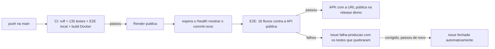

# Deploy da demonstração (custo zero)

| Peça | Onde | Plano | Observação |
|---|---|---|---|
| API (Docker) | [Render](https://render.com) | Free | Dorme após 15 min sem acesso; a 1ª chamada depois disso leva ~1 min |
| Banco PostgreSQL | [Neon](https://neon.com) | Free | 1 GB, não expira; dorme após 5 min e acorda em segundos |
| APK | GitHub Releases (`demo`) | grátis | Gerado pelo pipeline já apontando para a API pública |
| Pipeline | GitHub Actions | grátis (repo público) | CI, deploy verificado, E2E em produção, APK e registro de falhas |

## 1. Banco no Neon (uma vez)

1. Entre em neon.com com a conta do GitHub e crie um projeto `picped`, região **AWS US East 1 (N. Virginia)**.
2. Em **Connect**, copie a *connection string* (começa com `postgresql://` e termina com `?sslmode=require`).

As tabelas e os dados de demonstração são criados sozinhos na primeira subida da API (`python -m app.init_db`),
que nunca apaga dados de um banco que já tem tabelas.

## 2. API no Render (uma vez)

1. Entre em render.com com a conta do GitHub.
2. **New › Blueprint** › escolha o repositório `Picped`. O Render lê o `render.yaml`.
3. Cole a connection string do Neon em `DATABASE_URL` e confirme. O `SECRET_KEY` é gerado sozinho.
4. Quando terminar, anote o endereço (ex.: `https://picped-api.onrender.com`) e teste `/health`.

O `render.yaml` usa `autoDeployTrigger: checksPass`: cada push na `main` só vai para o ar depois que o CI passa.

## 3. Pipeline (uma vez)

No GitHub: **Settings › Secrets and variables › Actions › Variables › New repository variable**

- `PICPED_API_URL` = o endereço do Render, sem barra no final.

Depois: **Actions › Produção › Run workflow**. Ele testa a produção e publica o APK em
**Releases › demo**.

## Como o pipeline funciona

- **A cada 6 horas** o workflow *Produção* roda sozinho como monitor (sem gerar APK).
- **No dia da apresentação**, uns 10 minutos antes: **Actions › Manter acordado › Run workflow** (padrão: 3 horas).

## Celular

Baixe `Picped-demo.apk` em **Releases › demo**, permita instalar de fontes desconhecidas e abra.
O app já vem apontando para a API pública; dá para trocar em **Perfil › Servidor**.
Contas de demonstração: `ana@picped.dev`, `bruno@picped.dev`, `carla@picped.dev`, senha `picped123`.

> Cada APK do pipeline é assinado com uma chave de debug nova. Se o Android recusar a atualização,
> desinstale a versão anterior e instale de novo.
