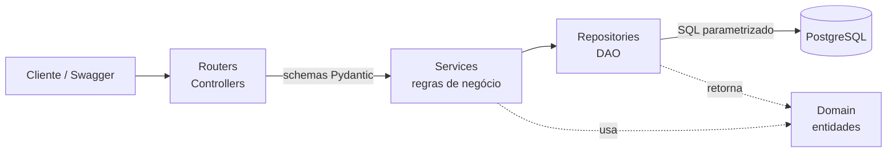
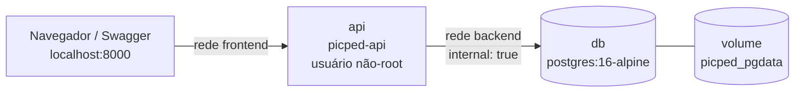

# Picped — Arquitetura do Backend

Stack: **Python 3.12 · FastAPI · SQLAlchemy (pool de conexões) · psycopg 3 · PostgreSQL 16**

## Camadas



| Camada | Pasta | Responsabilidade |
|---|---|---|
| Domain | `app/domain/` | Entidades do negócio (dataclasses), sem framework nem banco |
| Repository/DAO | `app/repositories/` | Único ponto de acesso ao banco; consultas parametrizadas |
| Service | `app/services/` | Regras de negócio, isoladas de HTTP e de SQL |
| Controllers/Routers | `app/routers/` | Rotas HTTP, validação de entrada/saída (`app/schemas/`) |
| Core | `app/core/` | Configuração, pool de conexões e tratamento centralizado de erros |

Fluxo de uma requisição: `Router → Service → Repository → PostgreSQL`. A injeção de dependências
(`app/dependencies.py`) monta Connection → Repositories → Services a cada requisição.

## Regras de negócio (Services)

- **Produto:** a categoria informada precisa existir; nomes são normalizados (sem espaços extras).
- **Preço:** produto, supermercado e usuário precisam existir; supermercado inativo não aceita preços;
  o registro é rejeitado se `distancia_metros` for maior que o `raio_metros` do supermercado
  (valida a geolocalização feita no app).
- **Comparação** (`GET /produtos/{id}/comparacao`): pega o preço mais recente em cada supermercado,
  ordena do mais barato ao mais caro e calcula a economia (R$ e %).
- **Supermercados próximos** (`GET /supermercados/proximos`): identifica o mercado a partir da
  latitude/longitude do usuário (função SQL `supermercados_proximos`).

## Pool de conexões

`app/core/database.py` cria **um único Engine** do SQLAlchemy (QueuePool) com `pool_size`,
`max_overflow`, `pool_timeout`, `pool_recycle`, `pool_pre_ping=True` e `connect_timeout`. Cada requisição pega uma conexão
do pool e a devolve ao final (com rollback automático se ocorrer erro). O pool é fechado no desligamento
da aplicação. Parâmetros configuráveis por variável de ambiente (`.env.example`).

## Segurança contra SQL Injection

Todos os **valores** chegam ao banco por *bind parameters* (`:nome`) via `sqlalchemy.text()`; nenhum valor
vindo do usuário é concatenado ao SQL. Nomes de tabelas e colunas vêm de constantes das classes
Repository (nunca da requisição).

## Tratamento centralizado de erros

`app/core/exceptions.py` registra handlers globais, e todas as respostas de erro têm o mesmo formato:

```json
{ "erro": { "codigo": "regra_de_negocio", "mensagem": "...", "detalhes": [] } }
```

| Situação | HTTP | Código |
|---|---|---|
| JSON mal formatado / PATCH vazio | 400 | `requisicao_invalida` |
| Registro não encontrado | 404 | `nao_encontrado` |
| Regra de negócio violada | 422 | `regra_de_negocio` |
| Dados de entrada inválidos (Pydantic) | 422 | `validacao` |
| Duplicidade (UNIQUE) | 409 | `registro_duplicado` |
| E-mail já cadastrado (regra do Service) | 409 | `conflito` |
| Chave estrangeira (FK) | 409 | `violacao_de_relacionamento` |
| Banco indisponível | 503 | `banco_indisponivel` |
| Rota inexistente | 404 | `nao_encontrado` |
| Método não permitido | 405 | `metodo_nao_permitido` |
| Erro inesperado | 500 | `erro_interno` (sem vazar detalhes) |

## Como executar localmente

```bash
python -m venv .venv
.venv\Scripts\activate          # Windows (PowerShell)
pip install -r requirements.txt
copy .env.example .env          # ajuste se necessário
uvicorn app.main:app --reload
```

Swagger: http://localhost:8000/docs

## Endpoints & Swagger — Etapa 4

Swagger UI em **`/docs`** (ReDoc em `/redoc`, especificação em `/openapi.json`). Cada schema de entrada
tem exemplo de payload, e cada rota documenta as respostas de erro possíveis com o schema `ErroOut`.

| Recurso | Listar | Criar | Obter | Substituir | Atualizar parte | Excluir |
|---|---|---|---|---|---|---|
| Categorias | `GET /categorias` | `POST /categorias` | `GET /categorias/{id}` | `PUT /categorias/{id}` | `PATCH /categorias/{id}` | `DELETE /categorias/{id}` |
| Produtos | `GET /produtos` | `POST /produtos` | `GET /produtos/{id}` | `PUT /produtos/{id}` | `PATCH /produtos/{id}` | `DELETE /produtos/{id}` |
| Supermercados | `GET /supermercados` | `POST /supermercados` | `GET /supermercados/{id}` | `PUT /supermercados/{id}` | `PATCH /supermercados/{id}` | `DELETE /supermercados/{id}` |
| Usuários | `GET /usuarios` | `POST /usuarios` | `GET /usuarios/{id}` | `PUT /usuarios/{id}` | `PATCH /usuarios/{id}` | `DELETE /usuarios/{id}` |
| Preços | `GET /precos` | `POST /precos` | `GET /precos/{id}` | `PUT /precos/{id}` | `PATCH /precos/{id}` (só `valor`) | `DELETE /precos/{id}` |

Rotas extras: `GET /produtos/{id}/comparacao`, `GET /supermercados/proximos?latitude=&longitude=`,
`GET /precos?produto_id=&supermercado_id=` e `GET /health`. Listagens aceitam `limit` (1–200) e `offset`.

### Status HTTP

| Status | Quando |
|---|---|
| 200 | GET, PUT e PATCH com sucesso |
| 201 | POST com sucesso (retorna o registro criado) |
| 204 | DELETE com sucesso (corpo vazio) |
| 400 | JSON mal formatado ou PATCH sem nenhum campo |
| 404 | Registro ou rota inexistente |
| 409 | Duplicidade (UNIQUE, e-mail já cadastrado) ou exclusão de registro em uso (FK) |
| 422 | Dados inválidos (Pydantic) ou regra de negócio violada |

### Validação estrita (schemas Pydantic)

- `extra="forbid"`: campo desconhecido no JSON → 422 (ex.: `senha_hash` não pode ser enviado).
- IDs, `raio_metros` e `distancia_metros` em modo `strict` (`"7"` não vira `7`); `ativo` só aceita `true/false`.
- Tamanhos, faixas (`latitude` −90..90, `valor` > 0 com 2 casas), `unidade_medida` restrita a `un/kg/g/l/ml`,
  EAN com 8–14 dígitos, e-mail com formato válido, senha com no mínimo 8 caracteres.
- PATCH: campos podem ser omitidos, mas campos obrigatórios não podem ser enviados como `null`.
- IDs na URL precisam ser > 0 (`GET /produtos/0` → 422 sem consultar o banco).

### Usuários

A senha chega em texto pelo HTTPS e é gravada só como hash **PBKDF2-SHA256** com salt aleatório
(`pbkdf2_sha256$iterações$salt$hash`). Nenhuma resposta devolve a senha ou o hash. O e-mail é salvo em
minúsculas e é único (409 se já existir).

## Conteinerização (Docker Compose) — Etapa 3



| Requisito | Onde está |
|---|---|
| Dockerfile multi-stage | `Dockerfile`: estágio `builder` instala dependências num venv; estágio `runtime` copia só o venv + `app/` |
| Usuário não-root | `Dockerfile`: usuário `picped` (UID 10001), `USER picped` |
| Orquestração PostgreSQL + API | `docker-compose.yml`: serviços `db` e `api` |
| Rede isolada | rede `backend` com `internal: true` — o banco não tem porta publicada e só a API o enxerga |
| Volume nomeado persistente | `picped_pgdata` montado em `/var/lib/postgresql/data` |
| Healthcheck + inicialização sincronizada | `db` usa `pg_isready`; `api` tem `depends_on: db: condition: service_healthy` |
| Extras de segurança | `read_only`, `cap_drop: ALL`, `no-new-privileges`, `.dockerignore` sem `.env`/`.git` |

O `schema.sql` e o `seed.sql` são montados em `/docker-entrypoint-initdb.d/` e rodam automaticamente
**só na primeira vez** (volume vazio). Para recriar o banco do zero: `docker compose down -v`.

### Como executar com Docker

```bash
copy .env.example .env            # Windows (Linux/Mac: cp)
docker compose up -d --build
docker compose ps                 # db e api devem aparecer como "healthy"
```

- Swagger: http://localhost:8000/docs
- Health: http://localhost:8000/health
- Acessar o banco: `docker compose exec db psql -U postgres -d picped`
- Conferir usuário não-root: `docker compose exec api whoami` → `picped`
- Logs: `docker compose logs -f api`
