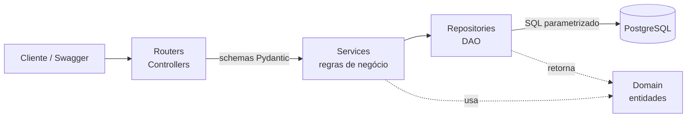
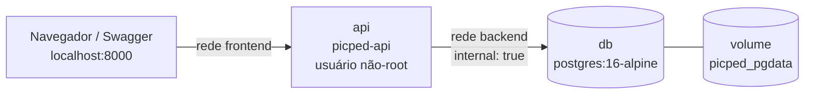

# Picped — Arquitetura do Backend (Etapas 2 a 4 + suporte ao app)

Stack: **Python 3.12 · FastAPI · SQLAlchemy (pool de conexões) · psycopg 3 · PostgreSQL 16**

## Camadas



| Camada | Pasta | Responsabilidade |
|---|---|---|
| Domain | `app/domain/` | Entidades do negócio (dataclasses), sem framework nem banco |
| Repository/DAO | `app/repositories/` | Único ponto de acesso ao banco; consultas parametrizadas |
| Service | `app/services/` | Regras de negócio, isoladas de HTTP e de SQL |
| Controllers/Routers | `app/routers/` | Rotas HTTP, validação de entrada/saída (`app/schemas/`) |
| Core | `app/core/` | Configuração, pool de conexões e tratamento centralizado de erros |

Fluxo de uma requisição: `Router → Service → Repository → PostgreSQL`. A injeção de dependências
(`app/dependencies.py`) monta Connection → Repositories → Services a cada requisição.

## Regras de negócio (Services)

- **Usuário:** e-mail normalizado em minúsculas e único; a senha é guardada só como hash PBKDF2-SHA256
  com salt (nunca aparece nas respostas).
- **Produto:** a categoria informada precisa existir; nomes são normalizados (sem espaços extras).
- **Preço:** produto, supermercado e usuário precisam existir; supermercado inativo não aceita preços;
  o registro é rejeitado se `distancia_metros` for maior que o `raio_metros` do supermercado
  (valida a geolocalização feita no app).
- **Comparação** (`GET /produtos/{id}/comparacao`): pega o preço mais recente em cada supermercado,
  ordena do mais barato ao mais caro e calcula a economia (R$ e %).
- **Supermercados próximos** (`GET /supermercados/proximos`): identifica o mercado a partir da
  latitude/longitude do usuário (função SQL `supermercados_proximos`).

## Pool de conexões

`app/core/database.py` cria **um único Engine** do SQLAlchemy (QueuePool) com `pool_size`,
`max_overflow`, `pool_timeout`, `pool_recycle`, `pool_pre_ping=True` e `connect_timeout`. Cada requisição pega uma conexão
do pool e a devolve ao final (com rollback automático se ocorrer erro). O pool é fechado no desligamento
da aplicação. Parâmetros configuráveis por variável de ambiente (`.env.example`).

## Segurança contra SQL Injection

Todos os **valores** chegam ao banco por *bind parameters* (`:nome`) via `sqlalchemy.text()`; nenhum valor
vindo do usuário é concatenado ao SQL. Nomes de tabelas e colunas vêm de constantes das classes
Repository (nunca da requisição).

## Tratamento centralizado de erros

`app/core/exceptions.py` registra handlers globais, e todas as respostas de erro têm o mesmo formato:

```json
{ "erro": { "codigo": "regra_de_negocio", "mensagem": "...", "detalhes": [] } }
```

| Situação | HTTP | Código |
|---|---|---|
| JSON mal formado | 400 | `json_invalido` |
| PATCH sem nenhum campo | 400 | `requisicao_invalida` |
| Registro não encontrado | 404 | `nao_encontrado` |
| Regra de negócio violada | 422 | `regra_de_negocio` |
| Dados de entrada inválidos (Pydantic) | 422 | `validacao` |
| Duplicidade (UNIQUE) | 409 | `registro_duplicado` |
| Chave estrangeira (FK) | 409 | `violacao_de_relacionamento` |
| Banco indisponível | 503 | `banco_indisponivel` |
| Rota inexistente | 404 | `nao_encontrado` |
| Método não permitido | 405 | `metodo_nao_permitido` |
| Erro inesperado | 500 | `erro_interno` (sem vazar detalhes) |

## Como executar localmente

```bash
python -m venv .venv
.venv\Scripts\activate          # Windows (PowerShell)
pip install -r requirements.txt
copy .env.example .env          # ajuste se necessário
uvicorn app.main:app --reload
```

Swagger: http://localhost:8000/docs

## Conteinerização (Docker Compose) — Etapa 3



| Requisito | Onde está |
|---|---|
| Dockerfile multi-stage | `Dockerfile`: estágio `builder` instala dependências num venv; estágio `runtime` copia só o venv + `app/` |
| Usuário não-root | `Dockerfile`: usuário `picped` (UID 10001), `USER picped` |
| Orquestração PostgreSQL + API | `docker-compose.yml`: serviços `db` e `api` |
| Rede isolada | rede `backend` com `internal: true` — o banco não tem porta publicada e só a API o enxerga |
| Volume nomeado persistente | `picped_pgdata` montado em `/var/lib/postgresql/data` |
| Healthcheck + inicialização sincronizada | `db` usa `pg_isready`; `api` tem `depends_on: db: condition: service_healthy` |
| Extras de segurança | `read_only`, `cap_drop: ALL`, `no-new-privileges`, `.dockerignore` sem `.env`/`.git` |

O `schema.sql` e o `seed.sql` são montados em `/docker-entrypoint-initdb.d/` e rodam automaticamente
**só na primeira vez** (volume vazio). Para recriar o banco do zero: `docker compose down -v`.

### Como executar com Docker

```bash
copy .env.example .env            # Windows (Linux/Mac: cp)
docker compose up -d --build
docker compose ps                 # db e api devem aparecer como "healthy"
```

- Swagger: http://localhost:8000/docs
- Health: http://localhost:8000/health
- Acessar o banco: `docker compose exec db psql -U postgres -d picped`
- Conferir usuário não-root: `docker compose exec api whoami` → `picped`
- Logs: `docker compose logs -f api`

## Endpoints e Swagger — Etapa 4

Documentação interativa gerada pelo FastAPI (OpenAPI 3.1):

- **Swagger UI:** http://localhost:8000/docs (a raiz `/` redireciona para cá)
- **ReDoc:** http://localhost:8000/redoc
- **OpenAPI JSON:** http://localhost:8000/openapi.json

### Rotas (CRUD completo)

| Recurso | GET (lista) | GET `/{id}` | POST | PATCH `/{id}` | DELETE `/{id}` | Extras |
|---|---|---|---|---|---|---|
| `/categorias` | ✔ | ✔ | ✔ | ✔ | ✔ | — |
| `/produtos` | ✔ | ✔ | ✔ | ✔ | ✔ | `GET /produtos/{id}/comparacao` |
| `/supermercados` | ✔ | ✔ | ✔ | ✔ | ✔ | `GET /supermercados/proximos?latitude=&longitude=` |
| `/precos` | ✔ (filtros `produto_id`, `supermercado_id`) | ✔ | ✔ | ✔ | ✔ | — |
| `/usuarios` | ✔ | ✔ | ✔ | ✔ | ✔ | — |
| `/health` | ✔ | | | | | verifica API + banco |

Listagens aceitam paginação: `?limit=` (1–200, padrão 50) e `?offset=` (≥ 0).

### Status HTTP

| Status | Quando acontece | Exemplo |
|---|---|---|
| **200** OK | GET e PATCH bem-sucedidos | `GET /produtos/1` |
| **201** Created | POST criou o registro (retorna o registro criado) | `POST /categorias` |
| **204** No Content | DELETE bem-sucedido (sem corpo) | `DELETE /precos/5` |
| **400** Bad Request | JSON mal formado ou PATCH com corpo `{}` | `PATCH /produtos/1` com `{}` |
| **404** Not Found | ID inexistente ou rota inexistente | `GET /produtos/9999` |
| **409** Conflict | UNIQUE duplicado ou registro em uso (FK) | e-mail já cadastrado |
| **422** Unprocessable Entity | Schema inválido (tipo, tamanho, campo extra, null em obrigatório, ID ≤ 0) **ou** regra de negócio | `POST /precos` fora do raio do mercado |

Cada rota declara no Swagger os status de erro que pode devolver, com o schema `ErroOut` e um exemplo.

### Validação estrita (Pydantic v2)

Todos os schemas de entrada herdam de `CreateSchema` / `UpdateSchema` (`app/schemas/base.py`):

- `extra="forbid"`: campo desconhecido → 422;
- `strict=True`: sem conversão silenciosa de tipos (`"5"` não vira `5`, `"true"` não vira `true`);
  só `valor` (Decimal) e `coletado_em` (datetime) aceitam texto, porque JSON não tem esses tipos;
- `str_strip_whitespace=True` + `min_length`/`max_length`, `pattern` (código de barras, e-mail),
  `gt`/`ge`/`le` (IDs, coordenadas, raio, preço com no máximo 2 casas decimais), `Literal` (unidade de medida);
- no PATCH, campos obrigatórios podem ser omitidos, mas não enviados como `null`.

Todo schema de entrada e saída tem **exemplo de payload** (`json_schema_extra.examples`), que aparece
preenchido no botão *Try it out* do Swagger.

## Suporte ao aplicativo Android (APS) — branch `feat/app`

Rotas adicionadas para o app (`mobile/`), sem alterar as rotas das etapas 1–4:

| Rota | Descrição |
|---|---|
| `POST /auth/login` | E-mail + senha → token Bearer (HMAC-SHA256, validade `TOKEN_HORAS`) |
| `GET /auth/me` · `DELETE /auth/me` | Usuário logado · excluir a própria conta e seus dados (LGPD) |
| `GET/POST /listas`, `GET/PATCH/DELETE /listas/{id}` | Listas de compras **do usuário logado** (403 para lista de outro usuário) |
| `POST /listas/{id}/itens`, `PATCH/DELETE /listas/{id}/itens/{item}` | Itens, quantidade e marcar como comprado |
| `GET /listas/{id}/comparacao` | Total da lista em cada supermercado, melhor opção e economia potencial (com a referência do cálculo) |
| `GET /produtos?busca=&codigo_barras=&categoria_id=` | Busca por nome/marca, EAN e categoria |
| `GET /produtos/{id}/historico` | Mínimo, máximo, média e variação, só com registros existentes |

- `POST /precos` com token exige que `usuario_id` seja o do próprio usuário (403).
- Novos status: **401** (sem token/expirado) e **403** (recurso de outro usuário).
- Banco: coluna `item_lista.comprado` (já no `schema.sql`; bancos antigos: `scripts/migracoes/001_item_lista_comprado.sql`).
- `scripts/demo.sql`: preços demonstrativos extras, carregados pelo compose depois do seed (o `seed.sql`
  dos testes não muda, exceto pelas senhas reais dos usuários demo: `picped123`).
- CORS configurável por `CORS_ORIGENS` (padrão `*`), para clientes web.
