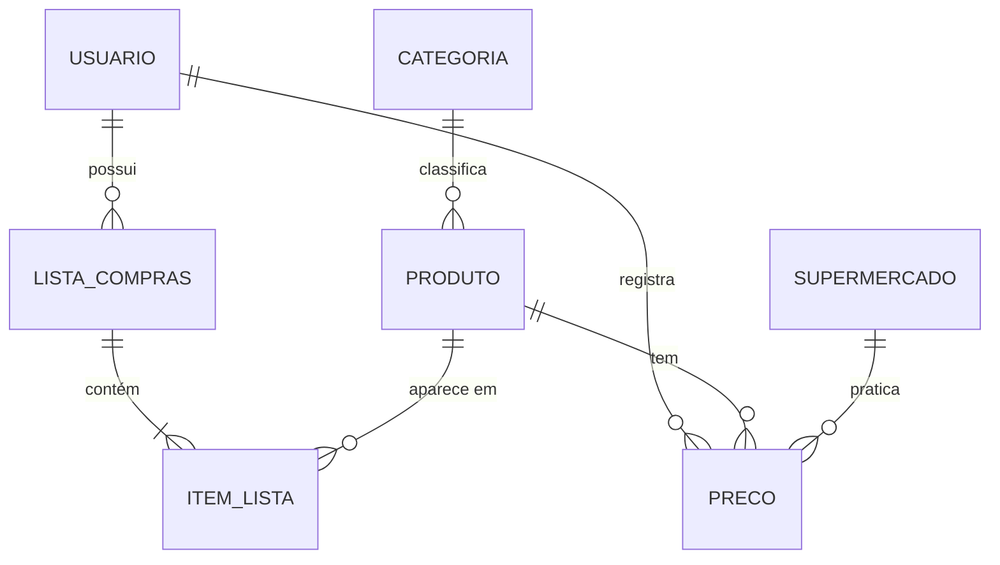

# Picped — Modelo de Dados e Dicionário de Dados

**Plataforma inteligente de comparação de preços e economia domésticos**
Disciplina: Linguagem de Programação de Banco de Dados — Prof. MSc. Mateus de Paula
SGBD: PostgreSQL 16 · Normalização: até a 3FN

## 1. Modelo Entidade-Relacionamento

### Cardinalidades

| Relacionamento | Cardinalidade | Observação |
|---|---|---|
| usuario → lista_compras | 1:N | Um usuário tem várias listas |
| lista_compras → item_lista | 1:N | Uma lista tem vários itens |
| produto → item_lista | 1:N | Um produto pode estar em várias listas |
| categoria → produto | 1:N | Uma categoria agrupa vários produtos |
| produto ↔ supermercado | N:N | Resolvido pela tabela `preco` (com histórico) |
| usuario → preco | 1:N | Quem registrou o preço |

## 2. Dicionário de Dados

### usuario
| Coluna | Tipo | Constraints | Descrição |
|---|---|---|---|
| id | SERIAL | PK | Identificador |
| nome | VARCHAR(100) | NOT NULL | Nome do usuário |
| email | VARCHAR(150) | NOT NULL, UNIQUE, CHECK (contém '@') | E-mail de login |
| senha_hash | VARCHAR(255) | NOT NULL | Hash da senha (nunca a senha pura) |
| criado_em | TIMESTAMP | NOT NULL, DEFAULT NOW() | Data de cadastro |

### categoria
| Coluna | Tipo | Constraints | Descrição |
|---|---|---|---|
| id | SERIAL | PK | Identificador |
| nome | VARCHAR(60) | NOT NULL, UNIQUE | Nome da categoria |

### produto
| Coluna | Tipo | Constraints | Descrição |
|---|---|---|---|
| id | SERIAL | PK | Identificador |
| nome | VARCHAR(120) | NOT NULL | Nome do produto |
| marca | VARCHAR(60) | — | Marca (opcional) |
| unidade_medida | VARCHAR(10) | NOT NULL, CHECK IN ('un','kg','g','l','ml') | Unidade de venda |
| codigo_barras | VARCHAR(14) | UNIQUE, CHECK (8 a 14 dígitos) | EAN, opcional |
| categoria_id | INTEGER | NOT NULL, FK → categoria(id) | Categoria |
| — | — | UNIQUE (nome, marca) | Evita produto duplicado |

### supermercado
| Coluna | Tipo | Constraints | Descrição |
|---|---|---|---|
| id | SERIAL | PK | Identificador |
| nome | VARCHAR(100) | NOT NULL | Nome da rede/loja |
| cidade | VARCHAR(80) | NOT NULL | Cidade |
| bairro | VARCHAR(80) | NOT NULL | Bairro |
| endereco | VARCHAR(200) | — | Endereço |
| latitude | NUMERIC(9,6) | NOT NULL, CHECK (-90 a 90) | Coordenada da loja |
| longitude | NUMERIC(9,6) | NOT NULL, CHECK (-180 a 180) | Coordenada da loja |
| raio_metros | INTEGER | NOT NULL, DEFAULT 80, CHECK > 0 | Tolerância para detectar o usuário dentro da loja |
| ativo | BOOLEAN | NOT NULL, DEFAULT TRUE | Loja ativa na plataforma |
| — | — | UNIQUE (nome, cidade, bairro) | Evita loja duplicada |

### preco
| Coluna | Tipo | Constraints | Descrição |
|---|---|---|---|
| id | SERIAL | PK | Identificador |
| produto_id | INTEGER | NOT NULL, FK → produto(id) | Produto |
| supermercado_id | INTEGER | NOT NULL, FK → supermercado(id) | Mercado (detectado por geolocalização) |
| usuario_id | INTEGER | NOT NULL, FK → usuario(id) | Quem registrou |
| valor | NUMERIC(10,2) | NOT NULL, CHECK > 0 | Preço em R$ |
| coletado_em | TIMESTAMP | NOT NULL, DEFAULT NOW() | Quando o preço foi visto |
| distancia_metros | INTEGER | CHECK >= 0 | Distância do usuário à loja no registro |

### lista_compras
| Coluna | Tipo | Constraints | Descrição |
|---|---|---|---|
| id | SERIAL | PK | Identificador |
| usuario_id | INTEGER | NOT NULL, FK → usuario(id) ON DELETE CASCADE | Dono da lista |
| nome | VARCHAR(100) | NOT NULL | Nome da lista |
| criada_em | TIMESTAMP | NOT NULL, DEFAULT NOW() | Data de criação |

### item_lista
| Coluna | Tipo | Constraints | Descrição |
|---|---|---|---|
| id | SERIAL | PK | Identificador |
| lista_id | INTEGER | NOT NULL, FK → lista_compras(id) ON DELETE CASCADE | Lista |
| produto_id | INTEGER | NOT NULL, FK → produto(id) | Produto |
| quantidade | NUMERIC(8,3) | NOT NULL, DEFAULT 1, CHECK > 0 | Quantidade desejada |
| — | — | UNIQUE (lista_id, produto_id) | Um produto por lista |

## 3. Índices

| Índice | Tabela | Colunas | Finalidade |
|---|---|---|---|
| idx_preco_produto_super_data | preco | (produto_id, supermercado_id, coletado_em DESC) | Preço mais recente e histórico |
| idx_preco_supermercado | preco | supermercado_id | Consultas por mercado |
| idx_preco_usuario | preco | usuario_id | Contribuições do usuário |
| idx_produto_categoria | produto | categoria_id | Filtro por categoria |
| idx_produto_nome | produto | LOWER(nome) | Busca por nome |
| idx_supermercado_coord | supermercado | (latitude, longitude) | Geolocalização |
| idx_lista_usuario | lista_compras | usuario_id | Listas do usuário |

## 4. Justificativa da normalização (3FN)

- **1FN:** todos os atributos são atômicos; não há grupos repetidos.
- **2FN:** todas as tabelas têm PK simples (`id`), então não há dependência parcial.
- **3FN:** não há dependência transitiva. Categoria, supermercado e usuário ficam em tabelas próprias, referenciadas por FK, em vez de repetir nome/bairro/etc. em `produto` ou `preco`.

## 5. Identificação do supermercado por geolocalização

A função `supermercados_proximos(lat, lon)` (em `scripts/schema.sql`) calcula a distância pela fórmula de Haversine e devolve até 3 mercados cujo `raio_metros` contém a posição do usuário, do mais próximo ao mais distante.
